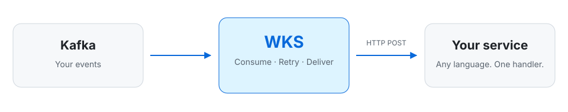
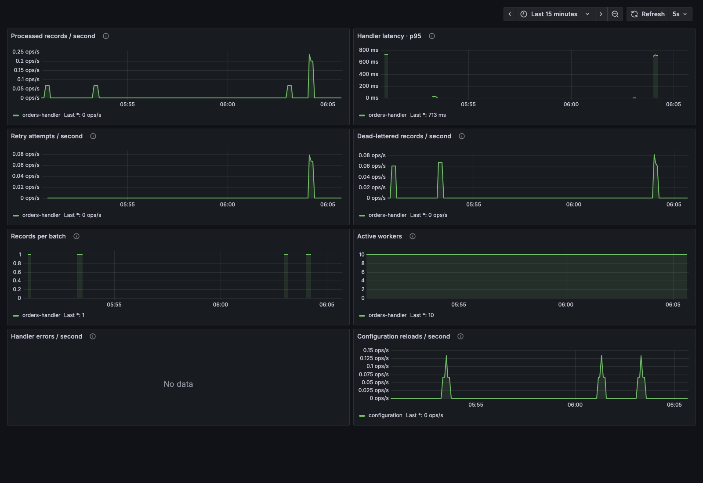
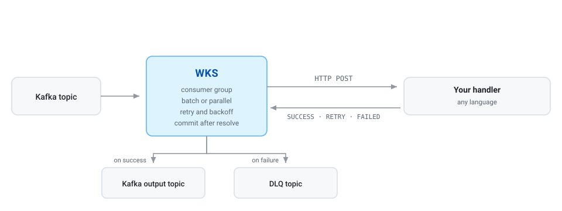

<div align="center">

# WolveKafka

**Consume Kafka with an HTTP handler.**

Write your business logic in any language. WKS handles consumer groups,
batching, retries, and dead-letter queues.

[How it works](#how-it-works) · [Quickstart](#quickstart) · [Examples](#try-the-interesting-parts) · [Compare](#how-it-compares) · [Deploy](#deploy) · [Discord](https://discord.gg/EPuXeJbG4j)

[](https://github.com/wolveflake/wolvekafka/actions/workflows/ci.yml)
[](LICENSE)
[](https://discord.gg/EPuXeJbG4j)

<picture>
  <source media="(prefers-color-scheme: dark)" srcset="docs/assets/wks-hero-dark.svg">
  
</picture>

</div>

Your service receives a batch over HTTP and returns a result for each record.
WKS handles what happens next: commit, retry, or send to a dead-letter topic.
No Kafka client in your application. No JVM or Connect cluster for WKS.

## How it works

Your whole integration is one HTTP endpoint. This is a complete handler in
Flask (`pip install flask`); any language that serves HTTP works:

```python
from flask import Flask, request
import base64

app = Flask(__name__)

@app.post("/")
def handle():
    results = []
    for record in request.json["messages"]:
        print(base64.b64decode(record["value"]))  # your business logic
        results.append({"status": 2})  # 2 = SUCCESS, 0 = RETRY, 1 = FAILED
    return {"messages": results}

app.run(port=8081)
```

Then point WKS at your cluster and your endpoint:

```json
{
  "cluster": {"bootstrap_servers": ["localhost:9092"]},
  "consumers": [{
    "group_id": "orders-handler",
    "topics": ["orders"],
    "lambdas": [{"url": "http://localhost:8081/"}]
  }]
}
```

Each record gets its own result. `SUCCESS` lets WKS commit it, and `RETRY` tries
it again with backoff. `FAILED` applies the DLQ or drop action you configure;
with neither, WKS holds the batch uncommitted rather than losing the record. If
your service is overloaded, return `429` and WKS waits, honoring `Retry-After`,
without using up the record's retries.
[Handler contract](docs/reference.md#handler-contract) ·
[all configuration options](docs/reference.md#configuration).

## Quickstart

You need **Git, Docker with Compose v2, Bash, and curl**. On Windows, use WSL2.
The first run downloads the released WKS image along with Kafka and Python;
startup time depends on your connection and Docker resources.

```bash
git clone https://github.com/wolveflake/wolvekafka.git
cd wolvekafka
./demo start
./demo send '{"order_id":"123","event":"order.created"}'
```

The demo starts Kafka, WKS, and two small Python handlers. It waits for health,
sends a readiness event through Kafka, then prints the handler result.
Your order produces a line like this (IDs and offsets vary):

```text
[handler A] demo-… orders[0]@1 SUCCESS: {"order_id":"123","event":"order.created"}
```

**You just processed a Kafka event with a Python HTTP handler.**
Next, change its business logic or try a failure below.



<details>
<summary>Startup trouble, logs, and cleanup</summary>

Run `./demo logs` to follow WKS and handler output. Startup failures print
container diagnostics; health and delivery checks have bounded waits.
Make sure ports 8080 and 8090 are free and Docker is running. With
`--observe`, ports 3000 and 9090 must also be free.

`./demo stop` removes the demo containers but retains Kafka data and runtime
configuration. `./demo reset --yes` also deletes this demo's Kafka volume and
runtime configuration. The next start uses the checked-in defaults.

See the [full demo guide](examples/quickstart/README.md) for direct Compose
commands and troubleshooting.

</details>

## Make it yours

Edit `process_order` in [handler.py](examples/quickstart/handler.py).
The example already handles HTTP, base64 decoding, and per-record responses:

```python
def process_order(order):
    print(f"Received order {order['order_id']}", flush=True)
    return SUCCESS
```

Restart the example handlers and send another event:

```bash
./demo restart-handler
./demo send '{"order_id":"124","event":"order.created"}'
```

Return `SUCCESS`, `RETRY`, or `FAILED`; the example maps these to WKS's
wire statuses. Your handler can use any language that serves HTTP.
See the [request and response contract](docs/reference.md#handler-contract)
and [connect your own Kafka](examples/quickstart/README.md#connect-your-own-kafka).

## Try the interesting parts

| Try it | What you will see |
| --- | --- |
| `./demo retry` | The same order returns `RETRY`, then `SUCCESS` after backoff. |
| `./demo dlq` | An invalid order returns `FAILED`; its original record appears in `orders.dlq`. |
| `./demo route b` | WKS reloads its config; subsequent events go to handler B. |
| `./demo route split` | Subsequent batches are weighted 50/50 between A and B. |

The routing command waits for WKS to apply the change. Use `./demo send`
to observe the selected handler. `./demo route a` restores the default.
Weights are probabilities per invocation, not an exact alternation.
The demo's simulated retry state is in memory per handler, not a production
deduplication implementation.

[Example walkthroughs and recording details](examples/quickstart/README.md#examples).

## See what is happening

```bash
./demo start --observe
./demo retry
```

Open [the local Grafana dashboard](http://127.0.0.1:3000/d/adpmcvw/wks).
Prometheus scraping, the Grafana data source, and the dashboard are provisioned
automatically. Allow a few scrapes for rate charts to populate.



Inspect throughput, batch size, handler latency, retries, and active workers.
These are measurements from your demo, not advertised throughput benchmarks.

WKS also continues traces across Kafka: it reads W3C `traceparent` from record
headers, passes it to your handler, and can export spans over OTLP. The demo
turns trace export off to keep its logs readable.
[Observability setup and metric reference](docs/observability.md).

## Why WKS?

| You want to… | WKS provides |
| --- | --- |
| Keep Kafka plumbing out of your application | One HTTP batch contract, in any language |
| Handle temporary and permanent failures | Backoff retries and explicit DLQ or drop policies |
| Protect an overloaded or rate-limited service | `429` and `Retry-After` pause delivery without spending retries |
| Spread work across service instances | Weighted HTTP targets, reselected on retry |
| Choose ordering or concurrency | Ordered batch processing or parallel workers |
| Change consumers without restarting WKS | Validated configuration hot reload |
| Operate with your existing tools | SASL/TLS/mTLS, Prometheus metrics, OpenTelemetry traces, Grafana, and Helm |

The best fit is a team whose processing logic belongs in an independently
deployed HTTP service: order handling, custom validation, or calling an
internal business API.

## How it compares

| Option | It may suit you better if… | WKS may suit you better if… |
| --- | --- | --- |
| Your own consumer | You need client-level control or in-process processing | You keep rewriting retries, DLQs, and rebalance handling in each service |
| Confluent HTTP Sink connector | You use Confluent Cloud, or already run a licensed Connect cluster | You want an open-source option without a Connect cluster |
| Redpanda Connect | You want many connectors, or transforms expressed in config | Your logic is a service you deploy and scale on its own |
| AWS Lambda event source mapping | You are on AWS and want managed, serverless scaling | Your handlers are long-running services you deploy anywhere |

## Delivery guarantees

WKS provides **at-least-once delivery**. Offsets are committed only after
handler results and any required Kafka output, durable DLQ, or explicit drop
action complete. Crashes can cause duplicates: make side effects idempotent
using a business key or topic/partition/offset.

Batch mode processes records in order; parallel mode can reorder records
within a partition. An omitted response status means **retry**, not success.

<details>
<summary>How success, retries, output, and dead letters fit together</summary>

<picture>
  <source media="(prefers-color-scheme: dark)" srcset="docs/assets/wks-flow-dark.svg">
  
</picture>

</details>

Read the [delivery and security guide](docs/delivery-and-security.md) before
using production traffic. [Configuration and metric reference](docs/reference.md).

## Deploy

- **Local evaluation:** `./demo start` runs the released image; `./demo start --build`
  builds WKS from this checkout.
- **From source:** `bazel run //go/wks/server -- --config_path=/absolute/path/to/config.json`.
- **Kubernetes:** follow the [Helm chart guide](services/wks/README.md).
- **Release artifacts:** see [release availability and verification](docs/releases.md)
  for Linux AMD64/ARM64 binaries, containers, and OCI charts.

The demo is local-only infrastructure, not a production deployment template.
[Connect your cluster and HTTP service](examples/quickstart/README.md#connect-your-own-kafka).

## Fit and project status

WKS is **early-stage software** with unit, race, and real-Kafka integration
coverage for the core delivery path. There is not yet a stable configuration
compatibility promise or broad managed-Kafka certification. OAuth and AWS MSK
IAM authentication are not implemented.

Limits worth knowing before you adopt it:

- Handlers are HTTP only for now; [gRPC is requested](https://github.com/wolveflake/wolvekafka/issues/97).
- Parallel mode can reorder records. [Per-key ordered fan-out](https://github.com/wolveflake/wolvekafka/issues/96)
  is not implemented yet.
- A stalled handler can hold its worker's other partitions, because batches
  stay uncommitted until they resolve. Monitor progress and configure a DLQ for
  poison messages.

WKS is designed for Kafka → HTTP processing → optional Kafka output.
For maintained source/sink connectors, evaluate a connector platform. For
stateful joins, windows, or exactly-once processing, use a system designed for
those requirements. WKS does not provide Schema Registry integration.

See the [roadmap](ROADMAP.md), [support policy](SUPPORT.md), and
[CI coverage](docs/ci.md). Feedback about real workloads is especially useful:
describe your event flow, expected ordering, and failure behavior.

## Community

Join the [WolveKafka Discord](https://discord.gg/EPuXeJbG4j) to ask questions, share your setup,
and follow announcements. Bugs and feature requests still belong in
[GitHub issues](https://github.com/wolveflake/wolvekafka/issues) so they are
tracked.

## Contributing

Start with the [contributor guide](CONTRIBUTING.md) and
[code of conduct](CODE_OF_CONDUCT.md). Report vulnerabilities using the
[private security reporting instructions](SECURITY.md).

## License

[Apache License 2.0](LICENSE) · [NOTICE](NOTICE)

Copyright 2023–2026 Wolveflake LLC (<https://wolveflake.io>).
