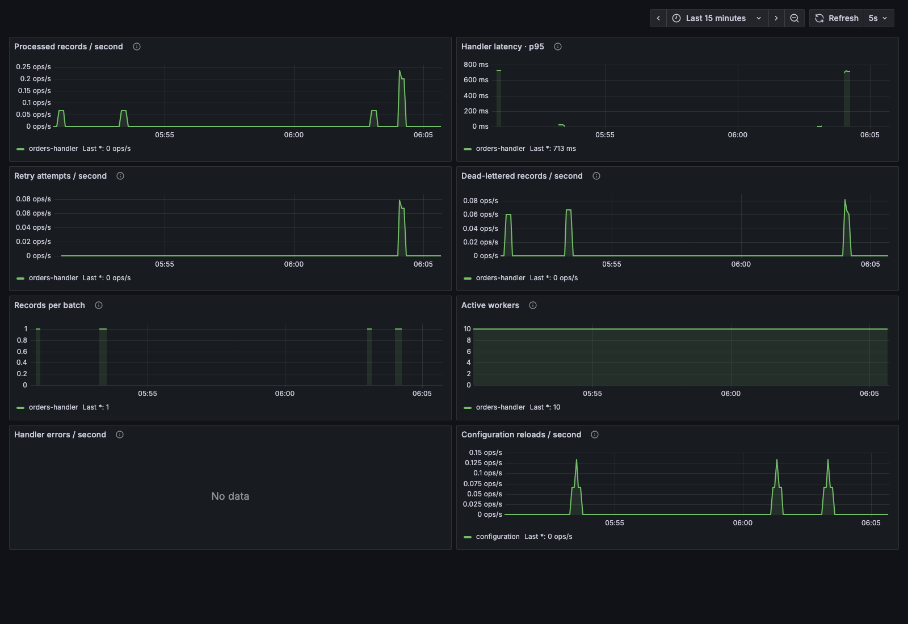

# Observe WKS

[Back to the quickstart](../README.md#quickstart)

```bash
./demo start --observe
./demo retry
```

Open [Grafana](http://127.0.0.1:3000/d/adpmcvw/wks). The optional Compose profile
starts Prometheus, configures a scrape every five seconds from `wks:8080`, and
provisions Grafana's Prometheus data source and the checked-in
[WKS dashboard](../WKS-Grafana.json). No manual dashboard import is needed.



Rate charts need multiple scrapes. A quiet demo has low or zero throughput;
send more events to see activity. The screenshot is a local demonstration,
not a capacity benchmark. No throughput or latency target is claimed.

| Endpoint | Purpose |
| --- | --- |
| <http://127.0.0.1:3000/d/adpmcvw/wks> | Grafana dashboard, anonymous read-only access |
| <http://127.0.0.1:9090/targets> | Verify Prometheus can scrape WKS |
| <http://127.0.0.1:8080/metrics> | Raw Prometheus metrics |
| <http://127.0.0.1:8080/health> | WKS process health, not proof of successful delivery |

The Compose ports bind to loopback. This local demo uses anonymous Grafana
viewing and ephemeral observability storage; configure authentication and
retention for a shared deployment. `./demo stop` stops all profile services.

## Use your own monitoring stack

Configure Prometheus to scrape WKS's `/metrics`, then configure Grafana with
that **Prometheus server** as its data source. Grafana does not directly scrape
the WKS endpoint. Import `WKS-Grafana.json` and bind its panels to your data
source. The example provisioning uses the dashboard's existing data source UID
`bf6mceododw5cf` so it works without editing panel JSON.

See the [Prometheus scrape configuration documentation](https://prometheus.io/docs/prometheus/latest/configuration/configuration/)
and [Grafana provisioning documentation](https://grafana.com/docs/grafana/latest/administration/provisioning/)
for the corresponding configuration formats. The working local files live in
[`examples/quickstart/observability`](../examples/quickstart/observability).

The [metric reference](reference.md#observability) lists instrumentation names;
the Prometheus endpoint exports names with underscores and counter/unit suffixes.
The dashboard contains queries for the exported names.

## Distributed tracing

WKS creates a `wks.process_batch` span (kind `CONSUMER`) for every batch and
propagates W3C trace context end to end:

- **From Kafka:** WKS reads `traceparent`, `tracestate`, and `baggage` from
  record headers. If every record in the batch carries the same span context
  (always the case for a traced single-record batch), the batch span continues
  that trace as its child. Otherwise the batch span starts a new trace and
  links to each distinct record span context, following the OpenTelemetry
  messaging conventions for batches.
- **To the handler:** the HTTP request carries `traceparent` (plus `tracestate`
  and `baggage` when present) for the batch span, so handler spans join the
  trace. Record headers are still delivered unchanged in the request body, so a
  handler can also continue each record's own trace.

Select the span exporter with the standard OpenTelemetry environment variables:

| Variable | Effect |
| --- | --- |
| `OTEL_TRACES_EXPORTER` | `otlp`, `console`, or `none`. Other values are rejected at startup. |
| `OTEL_EXPORTER_OTLP_ENDPOINT` | OTLP/HTTP endpoint, for example `http://otel-collector:4318`. When set and `OTEL_TRACES_EXPORTER` is unset, OTLP is used. |
| `OTEL_EXPORTER_OTLP_TRACES_ENDPOINT`, `OTEL_EXPORTER_OTLP_HEADERS`, … | Other standard OTLP/HTTP exporter settings. |
| `OTEL_SERVICE_NAME` | Service name shown in your tracing backend, for example `wks`. |

Without any of these variables, spans are printed to stdout as before. Set
`OTEL_TRACES_EXPORTER=none` to disable trace export in production if you do not
collect traces.

## Refresh the screenshot

With the observability profile running, send orders and exercise `./demo retry`
and `./demo dlq`. Wait for several scrapes, then run:

```bash
python3 scripts/demo/screenshot.py
```

The capture uses a temporary headless Chrome profile and closes it afterward.
Use `--chrome /path/to/chromium` if Chrome is not found automatically. Review
the saved PNG before committing it; capture real activity rather than changing
dashboard values for the image.
